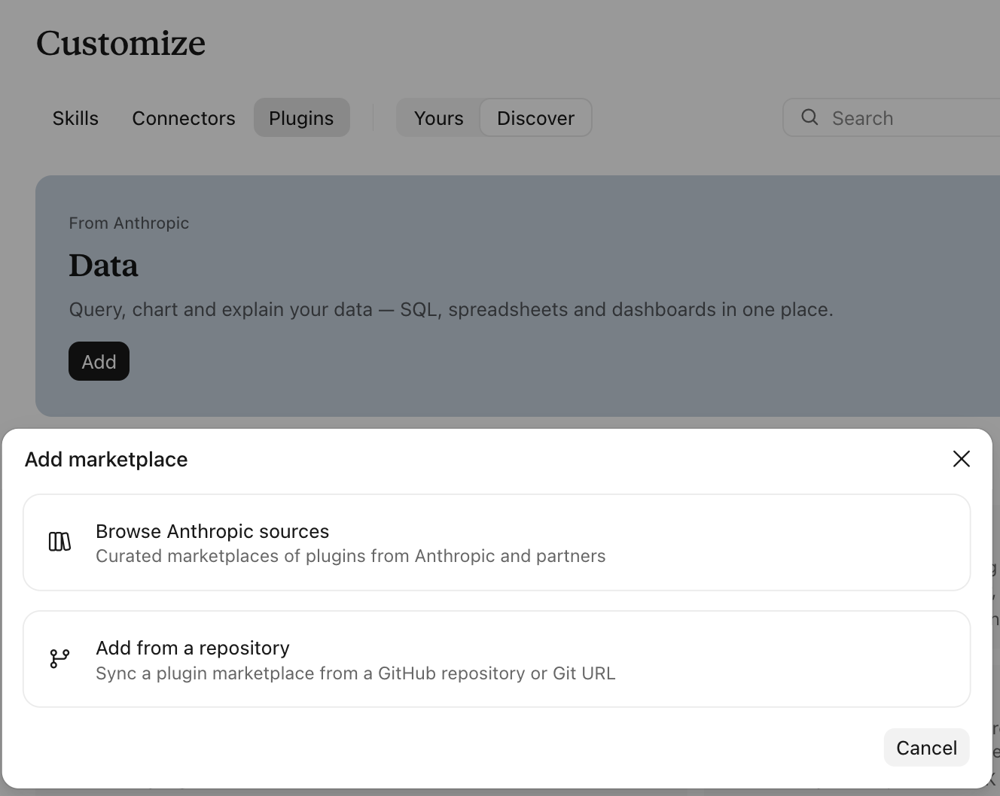

# Claudoperation

When AI writes most of the output, teammates can no longer see what each human actually contributed. Claudoperation fixes that with a **session record**: a short Markdown file, drafted by Claude and approved by you, that says what you decided, corrected and originated in a session with Claude, and which AI decisions nobody has reviewed. Teammates read it before the AI output.

## The problem

AI now writes most of the product, and nobody reads all of it. Teammates value human input most, but it stays in private chats.

<p align="center">
  
</p>

Claudoperation turns each session into a short record the author approves. Teammates, and their AIs, read the records before the product.

<p align="center">
  
</p>

## What you approve

`/claudoperation-approve` opens the capture record in a pane (an example record is shown). You tick the claims that are accurate, press `l` to fix labels, add evidence where a label needs it, and endorse the AI decisions you checked.

<p align="center">
  
</p>

## What's in the plugin

| Part | What it does | Where it runs |
| --- | --- | --- |
| `/claudoperation:capture` | Drafts a record of the session since the last capture, ranks your key contributions, and runs the validator | Claude Code; skills also load on claude.ai |
| `SPEC.md` | The record format, v0.1 | Inside the skill folder |
| `scripts/validate.mjs` | Checks a record against the spec (needs Node.js) | Anywhere |
| `/claudoperation:synthesize` | Writes your net story (what changed from your first record to your latest) and refreshes the Team block below | Claude Code; skills also load on claude.ai |
| `/claudoperation-approve` | A pane to tick claims, change labels, add evidence, and endorse AI decisions, then save | Claude Code terminal, Desktop app, VS Code (v2.1.287+) |

## Install

```bash
claude plugin marketplace add kakwok/claudoperation
claude plugin install claudoperation@claudoperation
```

To try it without installing, from a clone:

```bash
claude --plugin-dir ./plugins/claudoperation
```

### In the Claude app (claude.ai)

The skills work in the Claude app; the approval pane does not, because it only exists in Claude Code.

1. Open **Customize**, then **Plugins**.
2. Add a marketplace: choose **Add from a repository** and enter `kakwok/claudoperation`.
3. Install the `claudoperation` plugin from that marketplace.
4. In a chat, ask Claude to capture the session, or run `/claudoperation:capture`.
5. Approve by replying "ok" with any corrections, or by ticking the checkboxes in the file.
6. Download the record and add it to your repo at `sessions/<you>/`.

<p align="center">
  
</p>

## Use

1. Work with Claude as usual.
2. Run `/claudoperation:capture`. Claude writes `sessions/<you>/<date>-<slug>.md`.
3. Run `/claudoperation-approve` (it opens the newest pending record), tick what's right, fix labels, save.
4. Commit the record with your product changes.

Without the pane, edit the checkboxes in the file directly, or reply "ok" with any corrections.

## Team

<!-- claudoperation:martin:start -->
**martin** · 5 sessions, 2 approved · Direction 4, Origination 3, Correction 2, Choice 1 · human:AI claims 11:12 (informational, not a target)
Latest net story (unapproved): a before-and-after diagram of the problem, the approve command, and a Claude Code-only approval prompt. [Read it](sessions/martin/net/2026-11-05-net.md)
2 AI decisions unreviewed · 2 bulk approvals · 0 relabels · 0 overrides
<!-- claudoperation:martin:end -->

## Records in this repo

`sessions/martin/` holds the records of the conversation that designed Claudoperation. They are also the skill's worked examples.

## Develop

```bash
claude plugin validate ./plugins/claudoperation
cd plugins/claudoperation && claude plugin test
node plugins/claudoperation/skills/capture/scripts/validate.mjs sessions/*/*.md
```

Tested with Claude Code 2.1.317. The mod API is new and may change between releases.
